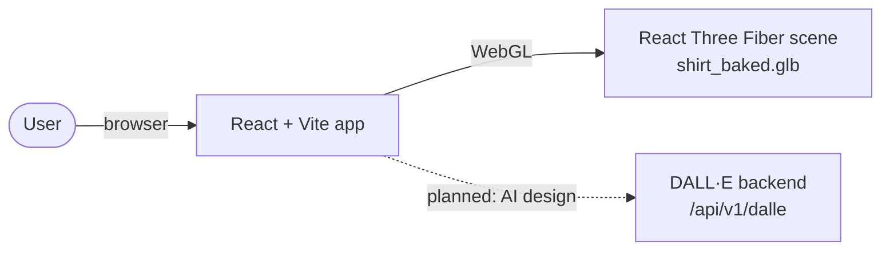

# Render Wear: High-Level Design

A 3D T-shirt customizer: an interactive shirt model that follows the cursor, with color and decal (logo or full print) state ready for the editor. Live at [render-wear.vercel.app](https://render-wear.vercel.app). The landing screen, 3D scene and state are built; the editor tabs (color picker, file upload, AI design) are placeholders. For code-level detail see the [Low-Level Design](lld.md).

## 1. Context

## 2. Screens

| Screen | Shown when | Content |
|---|---|---|
| Home | `state.intro = true` | Animated intro text and "Customize It" button |
| Customizer | `state.intro = false` | Editor tabs (left), filter tabs (bottom), "Go Back" |
| 3D canvas | Always | Shirt model with decals, lighting, camera rig |

## 3. Components

| Component | Responsibility |
|---|---|
| `store` (Valtio) | Global state: intro, color, decal toggles and images |
| `canvas/` | `CanvasModel`, `CameraRig`, `Shirt` |
| `pages/` | `Home`, `Customizer` with Framer Motion transitions |
| `components/` | `CustomButton` (color-aware); `Tab`, `ColorPicker`, `FilePicker`, `AIPicker` are stubs |
| `config/` | Backend URLs, tab definitions, helpers, motion presets |

## 4. Tech

| Item | Choice |
|---|---|
| UI | React, Vite, Tailwind CSS |
| 3D | three.js, @react-three/fiber, @react-three/drei, maath (easing) |
| State | Valtio |
| Animation | Framer Motion |
