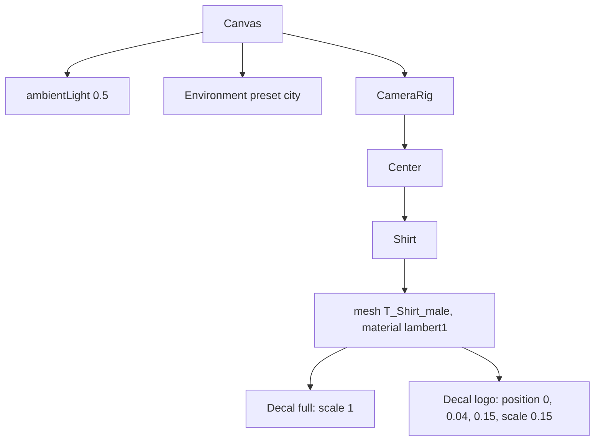

# Render Wear: Low-Level Design

For the big picture see the [High-Level Design](hld.md).

## 1. State (`store/index.js`)

| Field | Default | Meaning |
|---|---|---|
| `intro` | `true` | Home screen vs customizer |
| `color` | `#EFBD48` | Shirt color |
| `isLogoTexture` | `false` | Show the small chest logo decal |
| `isFullTexture` | `false` | Show the full-shirt print decal |
| `logoDecal`, `fullDecal` | `./threejs.png` | Decal images |

## 2. Scene graph

## 3. Per-frame behavior

| Component | Every frame |
|---|---|
| `Shirt` | `easing.dampC` blends the material color toward `state.color` (0.25 s) |
| `CameraRig` | Moves the camera toward a target position and tilts the model toward the pointer |

| Viewport | Camera target (intro) | Camera target (customizer) |
|---|---|---|
| > 1260 px | `[-0.4, 0, 2]` | `[0, 0, 2]` |
| ≤ 1260 px | `[0, 0, 2]` | `[0, 0, 2]` |
| ≤ 600 px | `[0, 0.2, 2.5]` | `[0, 0, 2.5]` |

## 4. Helpers (`config/helpers.js`)

| Helper | Behavior |
|---|---|
| `downloadCanvasToImage()` | Saves the WebGL canvas as `canvas.png` |
| `reader(file)` | Reads an uploaded file as a data URL |
| `getContrastingColor(hex)` | Black or white text based on brightness `(299R + 587G + 114B) / 1000 > 128` |

## 5. Configuration (`config/`)

| File | Content |
|---|---|
| `config.js` | DALL·E backend URL: `localhost:8080` in development, `devswag.onrender.com` in production |
| `constants.js` | `EditorTabs` (colorpicker, filepicker, aipicker), `FilterTabs` (logoShirt, stylishShirt), `DecalTypes` |
| `motion.js` | Framer Motion presets for slides and fades |

## 6. Remaining work

`Tab`, `ColorPicker`, `FilePicker` and `AIPicker` render placeholders, and the editor tab click handler is empty. Wiring them to `state.color`, `reader()` and the DALL·E endpoint completes the customizer.
